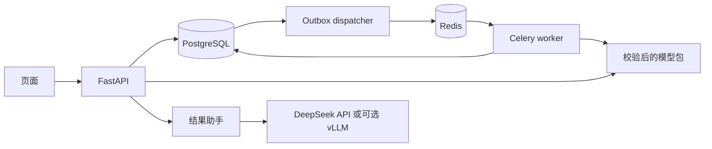

# 风电功率预测与实验交付平台

[](https://github.com/PlainSightX/wind-workbench/actions/workflows/verify.yml)

[](LICENSE)

**评分用的模型字节，就是服务加载的模型字节。** 这是面向预测研发人员的实验工作台：在页面或 API
提交训练任务，异步执行、比较模型，按模型版本回放历史预测，并由结果助手解释指标和选型依据。
数据来自公开的 ENGIE 风电场 SCADA，预测四台机组聚合功率未来 10–60 分钟；这是离线历史场景，
没有生产客户或电网接入。


## 解决什么问题

- **实验可靠执行。** 提交与投递消息同事务落库（outbox），worker 用租约和执行批次校验完成任务；
  进程被强杀后可安全重跑，重复投递只登记一个有效结果。
- **评分模型就是服务模型。** 模型包用 Hash 绑定训练配置、预处理和数据协议；预测服务加载原包，不重新训练。
- **结果有据可查。** 结果助手只读取已登记的指标和文档，由模型选择引用、程序绑定数值，再校验数值、单位与阶段。

## 关键结果

| 结果 | 数值 | 说明 |
| --- | --- | --- |
| ENGIE 2015 年留出评价，L1 + 持续性收缩 | 全场 MAE 较持续性 **−2.99%**（七天块 95% CI 2.75%–3.66%），RMSE **−4.04%** | 开发期改善 1.80%，未达预设的 3% 采用门，默认仍保留持续性 |
| Q1 单序列历史留出，Ridge | MAE 较持续性 **−7.26%** | 小型 Transformer 完成训练与交付，但未胜出 |
| 原模型跨环境回放 | 五个模型各 51,200 个合法起报，与原预测最大差 **4.55e-13 kW** | Linux CPU 容器中独立重载 |
| 查询规划微调 | Qwen3-8B + LoRA 首答通过率 **77.3%**，DeepSeek-Flash 41.3%、Qwen3-32B 33.7%；接入服务后端到端 **77.7%**（原始 8B 19.0%） | 300 题留出测试，[首答](docs/results/sft-obligation-8b-20261017/README.md) · [接入服务](docs/results/sft-service-integration-20261017/README.md) |

两组预测结果属于不同任务和数据合同，不能合并排名。全部结果与限制见 [精选结果](docs/public-results.md)。

## 快速开始

需要 PowerShell 7、Docker Desktop 和 [uv](https://docs.astral.sh/uv/)；容器使用 CPU，不需要 CUDA。

```powershell
pwsh -File tools/dev/start-app.ps1 -Build      # 启动 API、worker、PostgreSQL、Redis
pwsh -File tools/dev/check-service.ps1         # 可选：单测、真实 PG 与三个端到端实验
```

打开 `http://127.0.0.1:18000/`，在「实验任务」提交、在「结果比较」查看、在「历史预测」回放。
原 ENGIE 模型包与数据的获取步骤见 [独立复现](docs/public-reproduction.md)。

## 架构



沿主流程读代码：
[api/routes.py](src/power_forecast_service/api/routes.py) 提交与查询 →
[experiments/service.py](src/power_forecast_service/experiments/service.py) 冻结配置、幂等与 outbox 事务 →
[jobs/dispatcher.py](src/power_forecast_service/jobs/dispatcher.py) 投递 →
[experiments/execution.py](src/power_forecast_service/experiments/execution.py) 领取、租约与恢复 →
[jobs/worker.py](src/power_forecast_service/jobs/worker.py) 训练与登记 →
[forecasting/bundles.py](src/power_forecast_service/forecasting/bundles.py) 打包与独立重载 →
[api/forecasts.py](src/power_forecast_service/api/forecasts.py) 选版预测。
结果助手见 [assistant/workflow.py](src/power_forecast_service/assistant/workflow.py) 与
[validation.py](src/power_forecast_service/assistant/validation.py)。更多见 [架构说明](docs/public-architecture.md)。

## 局限

- 离线历史场景：2015 年数据已用于正式评价，不能再当盲测；整体改善不代表所有工况或其他场站。
- 实况到达延迟为模拟参数，不是真实遥测；没有生产部署、SLA 或客户收益。
- 结果助手的 24 题为开发题，不代表开放问答准确率；数值绑定不能代替语义判断。

## 文档

- [独立复现](docs/public-reproduction.md) · [复现核验记录](docs/public-verification.md) · [测试与 CI](docs/public-tests.md)
- [架构](docs/public-architecture.md) · [延迟实况监测](docs/engie-monitor.md) · [可选 vLLM 后端](docs/inference-backend.md)
- [精选结果](docs/public-results.md) · [结果报告索引](docs/results/README.md) · [助手困难案例](docs/public-assistant-case.md)
- [数据出处](data/README.md) · [第三方许可](THIRD-PARTY-NOTICES.md) · [模型附件说明](docs/third-party/MODEL-ARTIFACT-NOTICE.md)

自有代码采用 [MIT](LICENSE)。原模型附件随 [Releases](https://github.com/PlainSightX/wind-workbench/releases) 提供。
