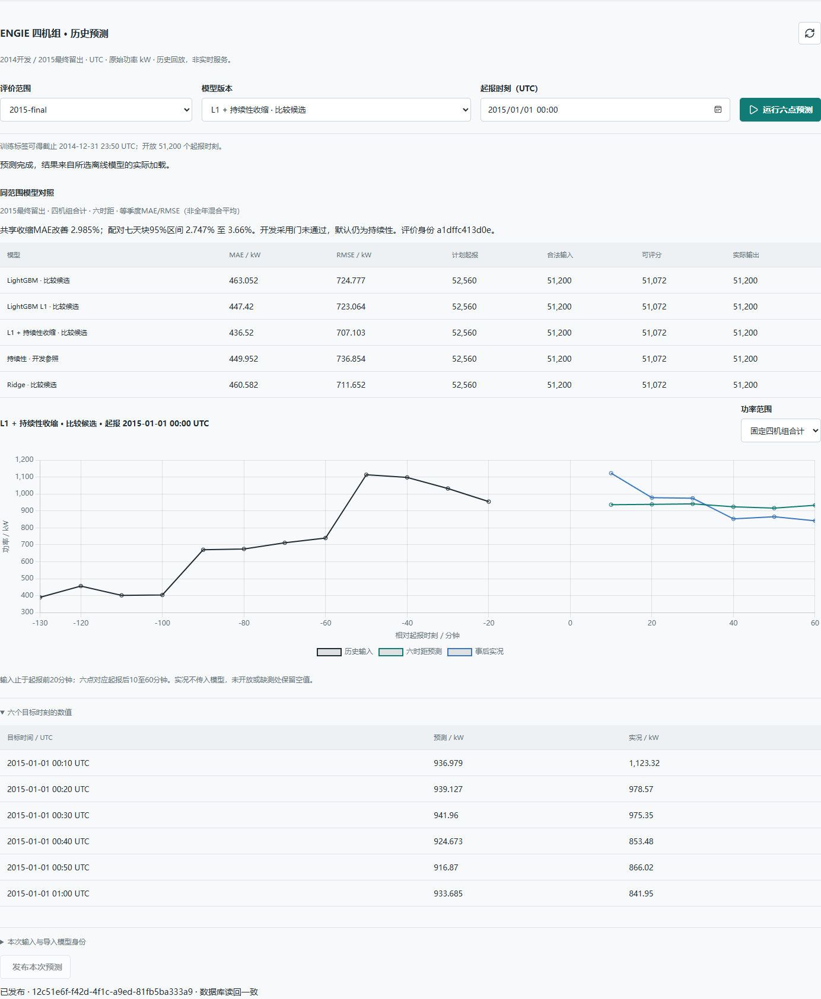

# 风电功率预测与实验交付平台

[](https://github.com/PlainSightX/wind-workbench/actions/workflows/verify.yml)

[](LICENSE)

基于公开风电场历史数据（ENGIE 四机组 SCADA）的实验与交付平台：在页面或 API 提交训练任务，异步执行、比较模型效果，按模型版本回放历史预测，并由结果助手解释指标和选型依据。平台要解决的一个核心风险是"评估时测的模型，和服务实际加载、线上跑的模型是不是同一份"——**评分用的模型字节，就是服务加载的模型字节**，由独立重放流程验证，不是靠约定。

平台由可靠异步实验执行、风电功率预测建模、NWP 气象信息价值研究、结果助手的大模型查询规划微调、推理服务工程五个部分共同构成。这是离线历史场景，没有生产客户或电网接入。

## 项目摘要

**主要工作**：搭建 Outbox+租约+心跳的可靠异步任务执行底座；在 ENGIE 风电数据上完成 baseline→A1→A2→A3 四轮递进建模，并独立做一条跨时距架构的 NWP 气象信息价值研究；为结果助手的查询规划子步骤做 Qwen3-8B LoRA 微调并接入服务端到端；围绕推理延迟做前缀缓存与请求布局的工程对照。

**成果**：A3 全年最终评价相对"持久性"基线（直接用当前发电量作为未来预测，电力行业最基础的对照标准）MAE 改善 2.99%，但未过预设 3% 开发采用门，默认模型仍是持久性；NWP 研究发现 GFS 在 4 小时时距相对 SCADA 臂改善 22.0%，10 分钟时距相对持久性臂反而变差 6.8%；给定证据的回答链路在 300 道同源留出题上，自动检查通过率从原始 8B 的 19.0% 升到 77.7%；定位出一个序列化顺序 bug，无需重训仅调整推理期字段顺序就把同一适配器从 50.0% 提到 77.7%。

**架构**：Outbox 任务提交 → Dispatcher 轮询 → worker 租约+心跳领取 → `clock_timestamp()` 判超时 → 模型包（manifest.json + SHA-256）独立子进程重放核验 → 结果落库；"评分字节=服务字节"由独立重放进程核验候选哈希一致后才登记结果，而不是约定。

**关键技术**：FastAPI + Celery/Redis 异步执行、PostgreSQL（Outbox/租约/`clock_timestamp()`）、LightGBM/scikit-learn 预测建模、GFS/ERA5 气象数据对照、LangGraph 结果助手、PEFT/LoRA + vLLM 微调与推理、Docker、GitHub Actions。



## ENGIE 主线：10–60 分钟功率预测

四个轮次递进：baseline 确立数据合同（Persistence vs Ridge vs LightGBM，两个学习模型全部弱于持久性）→ A1 把 baseline 模型接入真实服务（独立 Linux CPU 容器禁止重新拟合重放，最大差 4.5e-13 kW）→ A2 把训练目标从 L2 改成与评估一致的 L1，叠加持久性收缩机制 → A3 用冻结协议对 2015 全年做唯一一次最终评价。

| 轮次 | 结果 |
| --- | --- |
| A2（开发期机制实验） | L1+持久性收缩相对持久性改善 **+1.80%**，RMSE 降 3.35%，三季度均改善，但未达预设的 3% 开发采用门 |
| A3（2015 全年最终评价） | 相对持久性等季度 MAE 改善 **2.99%**（七天块 95% CI 2.75%–3.66%），RMSE 改善 4.04%；开发期采用门依然未通过，默认模型仍是持久性 |
| 模型可复现性验证 | 五个模型包各 51,200 个合法起报，独立进程禁止重新拟合全量重放，与原预测最大差 **4.55e-13 kW** |

这是一条如实记录"未达标也不放宽标准"的轮次：A2 没过 3% 门槛，A3 的最终评价结果同样没有追认采用——事前定好的门槛不因为后续结果好看就回头改。完整数据见 [baseline](docs/results/wind-engie-baseline-20260923/README.md)、[A2](docs/results/wind-engie-a2-20260923/README.md)、[A3](docs/results/wind-engie-a3-20260923/README.md)。

## NWP 气象信息价值研究：另一个模型架构，10 分钟–4 小时

**这是独立于 ENGIE 主线之外的第二个研究，模型架构不同——A2/A3 是逐时距独立训练，这里是每台机组训练一个跨时距合并模型，时距作为一列特征**，覆盖 10/20/30/60/120/180/240 分钟。对照纯 SCADA / +GFS 历史预报 / +ERA5 再分析三种输入：

- 4 小时时，+GFS 相对 SCADA 臂 MAE 改善 **22.0%**，相对持久性臂改善 27.2%；准确率（1 − RMSE/装机容量）从 85.2% 升到 88.1%。
- 10 分钟时 GFS 相对持久性臂反而显著变差（-6.8%）；20–30 分钟未检出差异。
- ERA5"先知"并未超过 GFS：按时距分别算的捕获比点估计在 1.06–1.15 之间，但各时距的置信区间都跨过 1，说明再分析在这个配置下不构成信息上界。

数据细节：GFS 0.25° 历史预报经 NCAR RDA d084001 获取，1,404 次运行抓取 7,020 个文件；发布延迟 5 小时是假设值，未实测到达时间；2015 年数据此前已用于 A3 最终评价，这次是同配方下换特征做的对照，不是新的盲测。完整设计与结果见 [时距研究](docs/results/nwp-horizon-2026-10-20/README.md)。

## 结果助手：查询规划微调 + 推理工程

**第三个独立任务线**：用 Qwen3-8B + LoRA 微调结果助手的"查询规划"子步骤（把问题转成结构化 `requests`），对比 Qwen3-32B 原始模型、DeepSeek-Flash。

| 实验 | 结果 |
| --- | --- |
| 首答规划（300 题留出） | Qwen3-8B+LoRA **77.3%**，DeepSeek-Flash 41.3%，Qwen3-32B 原始 33.7% |
| 接入服务端到端 | LoRA **77.7%**（233/300），原始 8B **19.0%**（57/300） |

两个工程发现：① 23k token 长样本反向传播时显式传因果掩码会退回内存高效内核，改用 `is_causal=True` 走 flash 路径后单次前反向从 29 秒降到 9 秒；② 训练目标用 `sort_keys` 序列化但约束解码按 schema 原序生成，导致模型系统性漏写字段，推理时把 schema 属性按字母序排列后同一适配器从 50.0% 升到 77.7%，无需重训。接入服务后的 67 题"交付但不通过"里，62 题其实是缺口措辞不一致被严格检查器误判为顺序错误，只有约 4 题是真正的语义失败——服务校验通过不等于回答语义正确，这条边界在报告里写明了。

推理工程另有一组前缀缓存对照：四种"提示布局×缓存"组合里，开启缓存整组用时降 10.2%，但逐题中位数仅降 0.43%，收益集中在两道纠错题；另一方案前缀复用率更高（67.5%）却多耗 25% 调用、多 50.7% 输出 token，评估后未采用。

详情见 [首答规划](docs/results/sft-obligation-8b-20261017/README.md)、[接入服务](docs/results/sft-service-integration-20261017/README.md)、[推理布局对照](docs/results/inference-i2-20261006/README.md)、[服务可靠性验证](docs/results/inference-i3-20261007/README.md)。

## 延迟实况监测与其他实验

- **延迟到达实况监测**（W1/W2）：主用/候选模型做滚动窗口对照评分，区分累计指标与当前窗口样本完整性，避免把不完整窗口误读为稳定对照；复核规则在首轮运行前冻结。W2 是纯工程改进——给 CLI/报告加窗口完整性展示，不否定 W1 结论。
- **Q1 单序列模型比较**（独立数据集）：Ridge（α=0.1）MAE 较持续性降 7.26%；小型 Transformer 完成真实训练与交付，但 MAE 反而恶化，不采用。
- 全部 16 份实验结果见 [结果索引](docs/results/README.md)。

## 快速开始

需要 PowerShell 7、Docker Desktop、[uv](https://docs.astral.sh/uv/)；容器用 CPU，不需要 CUDA。

```powershell
pwsh -File tools/dev/start-app.ps1 -Build      # 启动 API、worker、PostgreSQL、Redis
pwsh -File tools/dev/check-service.ps1         # 单测、真实 PG 与三个端到端实验
```

打开 `http://127.0.0.1:18000/`：三个功能区——提交实验任务、比较结果、历史预测回放。

复现 NWP 时距研究（CPU，不需要账号或付费 API）：

```powershell
python tools/research/nwp_horizon/fetch_gfs.py --cache .local/nwp-horizon/gfs
python tools/research/nwp_horizon/study.py --run
```

## 架构：三条可靠性设计

```
提交 ──► Outbox（任务与消息同事务落库）──► Dispatcher（SKIP LOCKED 轮询）──► Redis/Celery
                                                                              │
                                                                       worker 领取（租约 + 心跳）
                                                                              │
                                                              锁行 → clock_timestamp() 判超时 → 登记结果
```

**Outbox + 幂等**：任务提交与消息投递在同一事务落库；消息发送失败不删除记录，只推迟重试；重复投递由数据库唯一约束仲裁，只登记一个有效结果。

**租约 + 心跳**：worker 领取时绑定 `attempt_id` 和到期时间；进程被强杀后，到期的孤儿任务由定期扫描标记为过期并重新入队，不会静默卡死。

**`clock_timestamp()` 而非 `now()`**：PostgreSQL 的 `now()` 在同一事务内固定为事务开始时刻。如果等锁等了几秒才判断是否超时，用 `now()` 会得到过时的时间戳。项目在发布与查询的截止判断上都显式改用 `clock_timestamp()`，并在文档里写明了这个坑。

**模型包即服务**：训练产物打包时写入 `manifest.json`（含训练配置、代码哈希、全部文件 SHA-256）；独立子进程把 `fit()`、网络连接等已知训练与联网入口显式替换成抛异常的函数，检测重放过程中对这些入口的调用（不覆盖绕过 Python 层直接调用底层库的路径）；登记结果前核验候选哈希与独立验证产出一致，全部通过才在一个事务里落库——这正是"评分字节=服务字节"这句核心主张的实现方式。

## 技术栈

FastAPI、PostgreSQL、Celery + Redis、scikit-learn / LightGBM（预测建模）、PyTorch（序列模型对照）、mlflow（模型打包）、LangGraph（结果助手）、PEFT/LoRA + vLLM（查询规划微调与推理）、Docker、GitHub Actions。

## 局限

- 两组预测任务的模型架构不同，数值不能直接混用：A3 是逐时距独立训练的 10–60 分钟模型；NWP 研究是跨时距合并训练的 10 分钟–4 小时模型，用的是同一批 2015 年数据做特征对照。
- 全部实验是离线历史场景：无生产客户、无电网接入；到达延迟是模拟参数。
- 起报窗口高度重叠（滚动预测），不能当独立样本数；置信区间只反映该场站、该年度。
- 结果助手的检索与微调评测大多与训练同一生成器；NWP 的发布延迟是假设值，非实测到达时间。
- I2 的 10.2% 提速结论随后续请求合同变化，不能直接引用为当前服务的生产收益。

## 文档

- [结果索引（16 份完整实验报告）](docs/results/README.md)
- [NWP 时距价值研究设计](docs/results/nwp-horizon-2026-10-20/DESIGN.md)
- [推理后端配置](docs/inference-backend.md)
