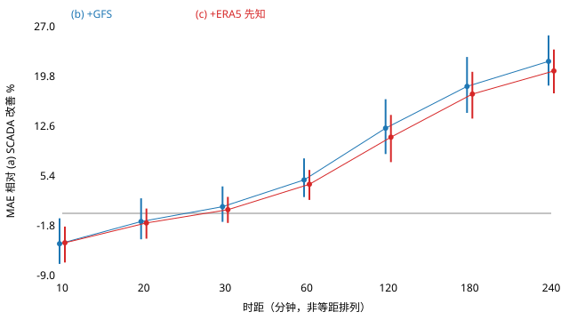

# 气象信息按时距的价值：SCADA / +GFS / +ERA5 对照

2026-10-20 完成。事前冻结设计后，对四机组合计功率做一次评价：只换特征集合，比较
仅用 SCADA、加入真实可得的 GFS 预报、加入 ERA5 再分析（预登记为“先知上界”）三种输入。

**结论：GFS 在 60–240 min 显著改善，在 10 min 显著变差，20–30 min 未检出差异。**
4 h 时 MAE 相对 SCADA 臂改善 22.0%，相对持久性改善 27.2%。预登记的 ERA5“先知”在
60–240 min 没有超过 GFS（捕获比点估计 1.06–1.15，区间包含 1），在这个配置下它
**并不构成上界**，原因分析见第 5 节。

设计与冻结：[DESIGN.md](DESIGN.md)，[protocol.json](protocol.json)（冻结后才运行，
sha256 记录在 [result.json](result.json)）。

## 1. 目的

中国风电超短期预测的考核时距是 15 min 到 4 h。本研究回答两个问题：天气信息从哪个时距
开始带来技能？真实可得的预报，能拿到“知道目标时刻真实天气”这一上界的多少？

## 2. 数据与许可

| 数据 | 用法 | 来源与许可 |
|---|---|---|
| ENGIE La Haute Borne SCADA | 四台 MM82（2050 kW，轮毂 80 m），十分钟 | OpenOA 固定提交，Open Licence 2.0，归属 ENGIE；不随仓库分发 |
| GFS 0.25° 历史预报 | 每次运行 f003–f015，站点格子四格点 | NCAR RDA d084001（[DOI](https://doi.org/10.5065/D65D8PWK)），NOAA/NCEP 产品，美国公有领域 |
| ERA5 逐时单层 | 同一格子四格点 | 经 Open-Meteo 历史 API（`models=era5`）；含修改过的 Copernicus 气候变化服务信息（2015），EC 与 ECMWF 对任何使用不负责；Open-Meteo 数据 CC BY 4.0 |

站点插值后的小 CSV 已提交在 [inputs/](inputs/)，sha256、请求 URL 与缺失文件清单见
[inputs/sources.json](inputs/sources.json)，也可以用下文脚本重新生成。

- **GFS 覆盖**：1404 次运行，计划抓取 7020 个文件；10 个返回 404（未归档），1 个返回 400
  （2015-06-07 06Z f006，重试仍失败）。为缺口所在运行的前一、前二运行补抓 f018–f027
  共 66 个文件。测试期各时距的 GFS 输入均 100% 有效；17,568×7 个键中 388 个用了前一运行
  的回退，0 个用到前二运行。实际时效 310–1250 min，均值 570 min。
- **ERA5 核对**：OpenOA ZIP 自带的 `era5_wind_la_haute_borne.csv` 没有格点和时区说明。
  与 Open-Meteo 四个格点对照后，它与 48.5N 5.5E 格点 2015 年 100 m 风速平均绝对差为
  0.024 m/s，零时差相关 0.9999，±1 h 错位时相关降到 0.969，因此可以确认它是**单一格点、
  UTC**。本研究改用四格点双线性插值版本，并补上它缺少的 10 m 风和阵风。
  Open-Meteo 的地面气压比 OpenOA 文件系统性高约 11 hPa（按其地形高度调整），只作为特征使用。

## 3. 设计

- **时距**：10、20、30、60、120、180、240 min。15 min 不在十分钟网格上，由 10 与 20 min 夹出。
- **模型**：A2/A3 的 LightGBM L1 参数（`regression_l1`，学习率 0.05，最多 400 树，31 叶，
  seed 42，早停 40 轮）。与 A2/A3 不同，每台机组训练**一个跨时距合并模型**，时距作为一列
  特征，四台预测相加；这一点在冻结前已写入设计。
- **对照臂**：持久性（起报前 20 min 的最新功率）；(a) 原 60 维 SCADA 历史＋时距；
  (b) (a)＋GFS 在目标有效时刻的轮毂风速、风向 sin/cos、10 m 风速、阵风、2 m 温度、地面气压；
  (c) (a)＋ERA5 在目标时刻的同七个量，轮毂风速 = 100 m × (80/100)^α，α = 0.224，
  只用训练期拟合。
- **GFS 可得性**：假设发布延迟 5 h，只用 reftime + 5 h ≤ 起报时刻的运行，取最新合格运行；
  reftime + lead = 有效时刻，在 3 h 步之间对 u/v 做线性插值；文件缺失时回退到前一或前二运行。
- **切分**：训练起报 2015-01-15 至 08-31（标签须在 9-01 前到达），内层早停用最后 28 天，
  测试起报 2015-09-01 至 12-31。**2015 年已是 A3 的最终评价年**，所以这不是此前模型的盲测，
  而是固定配方、固定切分下的特征对照，测试期不做任何调参。
- **评分键**：四台标签齐全，且三种输入都有效，四种方法使用完全相同的键；
  每个时距评分 17,496–17,526 个，计划 17,568 个。训练期因输入缺失剔除 2,114 行
  （起报, 时距）。
- **区间**：测试日历上非循环配对 7 天块，2000 次，seed 42，百分位 95% 区间，与 A3 方法一致。

## 4. 结果

四台合计，kW。准确率 = 1 − RMSE / 8200 kW，是对省级考核口径的近似，并不复现任何省的细则。

| 时距 | 持久性 MAE | (a) SCADA | (b) +GFS | (c) +ERA5 | 准确率 持久性 / a / b / c | (b) 较持久性 | (b)−(a) kW [95% CI] | (c)−(a) kW [95% CI] |
|---|---:|---:|---:|---:|---|---:|---|---|
| 10 min | 376.4 | 385.1 | 402.0 | 401.5 | 92.6 / 92.6 / 92.2 / 92.3% | −6.8% | +16.9 [+2.8, +30.8] | +16.4 [+6.9, +29.8] |
| 20 min | 425.0 | 425.6 | 430.6 | 431.5 | 91.8 / 91.9 / 91.7 / 91.8% | −1.3% | +5.0 [−8.5, +16.9] | +5.9 [−2.7, +16.9] |
| 30 min | 465.9 | 459.3 | 454.8 | 456.9 | 91.0 / 91.3 / 91.3 / 91.4% | +2.4% | −4.5 [−17.7, +5.8] | −2.4 [−10.9, +6.7] |
| 1 h | 557.9 | 540.7 | 514.6 | 518.0 | 89.4 / 89.9 / 90.3 / 90.3% | +7.8% | −26.1 [−43.8, −12.8] | −22.7 [−34.2, −10.3] |
| 2 h | 687.2 | 658.6 | 577.5 | 586.1 | 87.3 / 87.9 / 89.2 / 89.2% | +16.0% | −81.1 [−117.4, −52.7] | −72.6 [−101.9, −44.0] |
| 3 h | 785.2 | 747.4 | 610.2 | 618.5 | 85.7 / 86.4 / 88.6 / 88.6% | +22.3% | −137.2 [−186.6, −97.4] | −129.0 [−172.4, −88.9] |
| 4 h | 878.8 | 820.2 | 639.9 | 651.3 | 84.2 / 85.2 / 88.1 / 88.0% | +27.2% | −180.3 [−234.0, −134.5] | −169.0 [−218.6, −122.8] |

(b) 相对持久性的 MAE 改善 95% CI：10 min [−10.8, −2.4]%，1 h [5.2, 10.6]%，
4 h [24.2, 30.1]%。(a) 相对持久性：10 min −2.3%，4 h +6.7%。
捕获比 (a−b)/(a−c)：1 h 1.15 [0.79, 1.92]，2 h 1.12 [0.97, 1.39]，3 h 1.06 [0.97, 1.20]，
4 h 1.07 [0.99, 1.16]。完整逐时距指标、偏差与全部区间见 [result.json](result.json)。



按事前措辞：

- **GFS 显著改善**：60、120、180、240 min。**GFS 显著变差**：10 min。未检出差异：20、30 min。
- **先知 ERA5 显著改善**：60–240 min；显著变差：10 min；未检出差异：20、30 min。

## 5. 怎么理解

- **短时距**：10 min 时 SCADA 自身历史已经包含了“现在”的风；再加入站点格点平均、时效
  5 h 以上的天气场，主要提供噪声，跨时距合并模型在这一时距反而输给持久性。这一负结果
  照实保留，没有为 10 min 单独换配方。
- **长时距**：1 h 起天气信息的价值随时距单调增加，4 h 时把 SCADA 臂的 MAE 降低约 22%，
  RMSE 由 1214 降到 974 kW。
- **ERA5 不是上界**：设计时把“目标时刻的再分析”当作信息上界，但实测 GFS 并不比它差。
  可能的原因（没有分别做消融，属推测）：ERA5 是逐时值线性插值到十分钟，且轮毂风速由
  100 m 幂律外推；GFS 直接给出 80 m 风。两者都是 0.25° 格点量，对站点的偏差模型都可以
  从训练期学到；所以“真值天气”在这里并不比“好的预报”多出可利用的信息。
  因此“捕获比”不能读作 GFS 已拿到全部可得收益，只说明在此特征与模型下二者相当。
- 两种气象臂在长时距都有约 −140 至 −180 kW 的平均偏低（L1 目标下的中位数倾向），
  主指标改善不意味着偏差同步改善。

## 6. 局限

- 2015 年此前已用于 A3 最终评价，测试期不是盲测；只是同配方下的特征对照。
- 单一场站、四台机组、法国内陆地形，不代表其他风资源或中国场站。
- GFS 0.25°（约 18×28 km）格点量对场站的代表性有限；发布延迟 5 h 是假设值，并非实测到达时间。
- ERA5 是再分析，起报时不可得，只作为对照，任何地方都不称为预报。
- 测试期只有四个月（9–12 月），季节覆盖不全；起报窗口高度重叠，键数不等于独立样本数。
- 准确率公式只近似省级考核，不含限电剔除、开机容量和分时段规则。
- 合并模型的结构与 A2/A3 的逐时距模型不同，SCADA 臂的数值不能与 A3 的表格直接混用。

## 7. 复现

在项目根目录，使用已有环境（numpy / pandas / lightgbm / scipy）；不需要 GPU、账号或付费 API。

```powershell
# 1. GFS：约 7000 次请求，并发 4，可续跑；缺失文件写入 fetch-log.jsonl
python tools/research/nwp_horizon/fetch_gfs.py --cache .local/nwp-horizon/gfs
# 只为缺口相邻运行补抓回退所需的长时效（运行号见 inputs/sources.json）
python tools/research/nwp_horizon/fetch_gfs.py --cache .local/nwp-horizon/gfs --runs <YYYYMMDDHH ...> --leads 18 21 24 27
# 2. ERA5（Open-Meteo，无需密钥）
cd tools/research/nwp_horizon
python fetch_era5.py --output ../../../.local/nwp-horizon/era5_open_meteo_2015.json --start 2015-01-01 --end 2016-01-01
# 3. 站点插值，生成 inputs/（与已提交的 sha256 对比）
python build_inputs.py --gfs-cache ../../../.local/nwp-horizon/gfs --era5-raw ../../../.local/nwp-horizon/era5_open_meteo_2015.json --output <新目录>
cd ../../..
# 4. 已冻结、已评价：run 会拒绝覆盖。新复现请把 OUTPUT 改到另一目录后依次 freeze / run / report
python tools/research/nwp_horizon/study.py report
```

`run` 需要 ENGIE 原始 ZIP（`--source-zip`，获取方式与 sha256 见
[公开复现说明](../../public-reproduction.md)）。单元测试：
`python -m pytest tests/unit/forecasting/test_nwp_horizon.py`，覆盖起报可得运行的选择
（不使用未来运行）、时效与有效时刻的换算、缺文件回退、幂律轮毂高度换算，以及训练标签
不读取测试期的泄漏守卫。单次 `run` 在本机 CPU 上约 2 分钟（三臂共 24 次估计器拟合）。

代码：[timing.py](../../../tools/research/nwp_horizon/timing.py)（时间规则）→
[study.py](../../../tools/research/nwp_horizon/study.py)（特征、训练、指标、区间），复用
`forecasting/engie_contract.py` 的数据准入与特征，以及 `engie_l1.py` 的参数。
