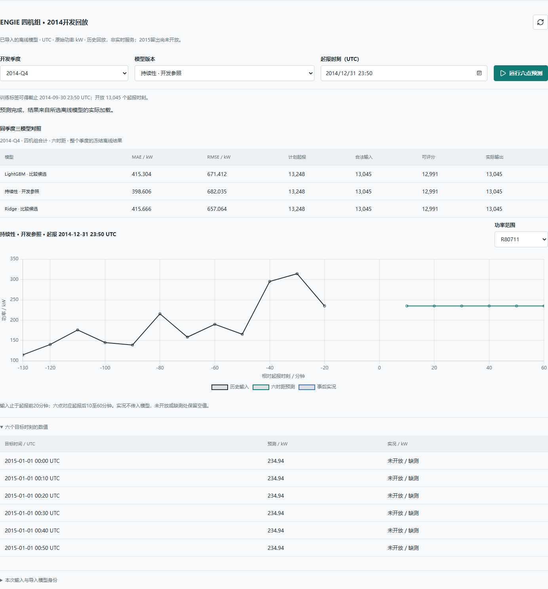

# ENGIE进入工作台：A1交付

本轮完成已批准的A1：已有离线模型通过真实PostgreSQL登记，在同一应用中选择季度、
模型和起报时刻，查看四台机组六时距预测、同协议误差与覆盖。没有新增业务训练、
参数选择或2015评分；本轮成果是可用接入，不是新增预测增益。

入口：启动后打开“历史预测”页面，页面下方的“ENGIE四机组”区域。
默认持续性是当前开发参照，Ridge和LightGBM仍标为比较候选。

## 实际交付

- 三个2014开发季度各三模型，共九个原始joblib模型。导入对象有独立运行/工件身份，
  不借用也不制造训练Task/Attempt。首次与重复导入返回相同的三个导入身份、九个版本。
- 先以代码锚定的历史baseline/protocol哈希验证来源，再加载模型；不提供任意pickle上传。
  保存来源协议、训练标签可得截止、原环境和CPU推理环境。九包全部复核后事务登记，
  中断时不暴露半组ready；重入不覆盖冲突内容。
- 输入明确要求UTC、四台固定机组、12条连续十分钟历史。最新输入是起报前20分钟，
  目标是起报后10至60分钟。输出保留原始kW负值，四台合计不填零、不漏算。
- 页面支持同季度三模型MAE/RMSE与计划/合法/可评分/输出分母，选择单机或全场曲线，
  六点数值和输入/模型身份。切换选择立即隐藏旧结果，延迟返回不覆盖新选择。
- 合法历史但缺事后实况仍可预测。2014末起报可生成跨年目标预测，但2015实况为null；
  2015起报入口不开放，线上派生历史文件只包含2014。

## 验收证据

| 范围 | 本轮实测结果 |
|---|---|
| 独立Linux CPU、禁止fit加载 | 九包全量合法输入重放；Ridge最大差4.547473508864641e-13kW，其余两类差0 |
| 事前数值容差 | 单机逐点atol=1e-6kW、rtol=1e-8；未放宽 |
| 真实HTTP | 每包首/中/末，共27组；4×6形状、UTC/kW、原预测、直接输入与历史回放一致 |
| 重启持久性 | 应用镜像重建/服务重启后，仍选择同一导入版本；27组复验通过 |
| 真实PostgreSQL | 导入第二组写入时注入中断，事务全部回滚；重试/重导仅九包；迁移往返保留旧任务 |
| 输入与完整性 | 缺机组、断档、过期输入、非UTC、非有限数、2015起报、坏包拒绝；合计溢出稳定拒绝 |
| 定向后端 | 47项通过，包含新合同/导入/真实PG/HTTP及受影响的Q1合同、回放和容量检查 |
| 真实浏览器 | 3场景通过，1440px/390px、上海/洛杉矶时区，六点数值、非空曲线像素、无页面横向溢出、旧响应隔离与错误显示 |
| 原Q1保护 | 17任务、18attempt、17run、23模型的整行快照hash不变；代表性原模型回放完全一致 |

完整来源：[CPU首次导入](cpu-import.json)、[幂等重导](cpu-reimport.json)、
[HTTP](http-verification.json)、[重启后HTTP](http-after-restart.json)、
[后端测试](focused-tests.xml)、浏览器检查。测试库均为夹具拥有的随机PG库，
测试结束已清理；未在业务库注入损坏或回滚迁移。

## 关键实现与复用

合同从[engie_service_contract](../../../src/power_forecast_service/forecasting/engie_service_contract.py)
进入；[导入](../../../src/power_forecast_service/storage/engie_imports.py)负责来源、CPU复核和事务，
[文件边界](../../../src/power_forecast_service/storage/engie_packages.py)不引入ORM，
[推理/回放](../../../src/power_forecast_service/forecasting/engie_predictor.py)负责合法历史到六点输出，
[路由](../../../src/power_forecast_service/api/engie.py)复用原容量门禁，
[页面](../../../web/src/engie.js)消费同一HTTP响应。无新增微服务或无用途的预测队列。

CPU runtime从现有uv锁导出LightGBM，镜像显式安装libgomp1；宿主CUDA环境未重新同步。
原engie_contract/engie_baselines源码、模型和预测文件未修改。

复现入口：先用 `tools/dev/import_engie.py stage` 打包代码锚定的原始来源，再在当前
Compose API镜像/配置下运行同脚本 `import`，它在禁止fit的新进程复核后登记。
日常 `tools/dev/start-app.ps1` 与打开页面不重新导入、不训练。精确源路径和本轮
执行回执另行保留，用户不需要手找joblib或抄工件编号。

## 限制和下一轮

持续性仍领先ENGIE当前主MAE；本轮未产生新的精度提升。前端错误注入测试只证明错误
展示；真实坏包拒绝另由专属PG/HTTP集成测试证明，二者不混作生产故障证据。
事务中断测试不等于所有文件系统/进程崩溃已覆盖；同机CPU验证不等于跨任意平台保证。
原数值库有3条既有timedelta弃用警告，未为清理警告改动冻结算法。

下一步是[A2有限L1与共享收缩实验](../wind-engie-a2-20260923/README.md)，仍需事前冻结并保留负结果；
2015年最终评价与交付故障对照在[A3](../wind-engie-a3-20260923/README.md)完成。
